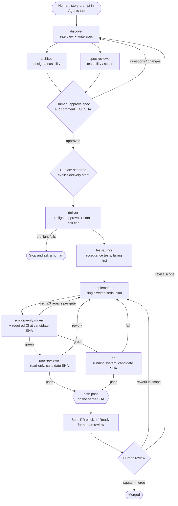

# How the agentic workflow works

A reusable explanation of the spec-to-PR process the agent definitions in
`.github/agents/` describe: the lifecycle, the roles, and which parts are real
contracts versus conventions an agent is asked to follow. The step-by-step guide
for people is [`human-playbook.md`](human-playbook.md); the operator overview is
the root [`README.md`](../../README.md).

## In one paragraph

A story goes from a rough idea to a merged PR in halves separated by human
decisions. **Discovery:** `discover` interviews the requester and writes a spec;
`architect` and `spec-reviewer` challenge it independently, read-only. **Human
approval:** a person with write access approves the spec's *Approved scope* with a
PR comment, then — as a **separate** act — starts delivery. **Delivery:** `deliver`
coordinates `test-author` (tests first), `implementer` (the only writer), then
`peer-reviewer` **and** `qa` against one candidate commit. A person reviews the
evidence and squash-merges. Agents never approve or merge.

## Lifecycle

Peer review and QA are a **join**: the candidate is Ready only when **both** pass
on the same SHA — not either one.

Any change to code, tests, the base branch, the approved scope or any other tracked
file makes earlier review and QA results stale; rerun affected gates on the next candidate.
A later HEAD reuses evidence only for a **bookkeeping-only** change to the story
spec outside Approved scope, with every other tracked file unchanged, recorded
as an explicit `candidate → HEAD` mapping. Required CI still follows current-head
repository rules; never describe earlier checks as having run on HEAD.

## Why it's shaped this way

- **Two human gates, kept separate.** Approving the scope and starting delivery are
  distinct events so a "looks good" never silently becomes "ship it".
- **Tests before code, one writer.** Acceptance tests encode the ACs before the
  implementer (the single writer) touches production code. This makes the tests
  less dependent on the author's narrative; green tests alone still do not prove
  that the requirements or their coverage are correct.
- **Independent review and QA.** A second opinion and an exercise of the running
  system catch what the writer can't see in their own work.
- **Evidence over assertion.** Approval, candidate SHA, review verdicts and QA
  artifacts are things a human can open; an agent's say-so is not a gate.

## Who does what

Eight definitions under [`.github/agents/`](../../.github/agents/). This is the
**canonical** role table; the README and playbook reference it instead of
repeating it.

| Role | Launched by | Reads | Writes | Must never |
|---|---|---|---|---|
| `discover` | Human (Agents tab) | story, `AGENTS.md`, `REVIEW.md`, code | the spec only | write code, grant approval |
| `architect` | `discover` or human | spec, code, `REVIEW.md` | nothing (notes in its output) | edit the spec, approve |
| `spec-reviewer` | `discover` or human | spec, `REVIEW.md` | nothing (verdict in its output) | edit the spec, approve |
| `deliver` | Human, after approval + start | spec, approval record, PR state | spec bookkeeping (Progress, Review log, PR block) | approve, merge, widen scope |
| `test-author` | `deliver` or human | spec ACs, existing tests | test files only | touch production code, weaken tests |
| `implementer` | `deliver` or human | spec plan, code | code + tests | widen scope, weaken tests, rebase/force-push |
| `peer-reviewer` | `deliver` or human | diff at candidate SHA, spec, `REVIEW.md` | nothing (verdict) | check out or edit code |
| `qa` | `deliver` or human | spec, running app at candidate SHA | evidence artifacts | self-approve visual baselines |

Where agent-to-agent handoff isn't available, `deliver` carries the `test-author`
and `implementer` responsibilities **sequentially in one coordinator session** by
reading their definitions — a labelled convention, **not** independent sessions or
models. **Peer review is a separate session**; **QA is preferably separate** and
must disclose when it isn't. A human does not normally launch eight sessions.

## Where state lives

Everything durable is in **the spec file on the PR branch**; the PR description is
a copy of its PR-description block.

| Spec section | Mutable? | Purpose | Authority |
|---|---|---|---|
| `Approved scope` | Only during discovery / approved revision | The contract: risk tier, problem, goals, non-goals, ACs, design, plan, acceptance-test files | **Authoritative** once approved |
| `Approval record` | Written once per approval | The approved full SHA, who, when, plus the separate delivery start | **Authoritative** (backed by the linked human PR comment) |
| `Progress` | Every step | Resume hint for a new session | **Not** authoritative |
| `Plan status` | Every task | Which plan tasks are done | Bookkeeping |
| `Review log` | Every gate | Gate, candidate SHA, findings, resolution | Evidence (must name the SHA) |
| `QA / UX matrix` | Per QA run | Cases, data, baseline, result, artifact link | Evidence |
| `PR description` block | Any time | Copied into the PR by `story-pr.yml` on push | Cosmetic |

## Model independence

A high-capability, approved model does the primary design, implementation and
review; this document pins no version list and asserts no provider superiority.
Independence is an **evidence** requirement: the implementer and the peer reviewer
should be **demonstrably different actual models**, selected in the supported UI.
Model identity may be unknown and is never inferred from file names, prompts or
role labels. If the reviewer's model is unknown or the same as the implementer's,
apply a **pre-agreed one-time policy** — typically a separate human high-capability
review — and record that; do **not** claim diversity you can't show. Required
automated checks are never waived for scope or risk.

## QA and UX evidence

`qa` works from the approved spec against the **running, integrated app**. The
baseline for the pilot is the **real current Playwright setup**, which starts the
API and UI together (`ui/playwright.config.ts`) — there is **no preview-environment
prerequisite**. Cover protected journeys plus error and negative paths with
**seeded, synthetic data** (no production or personal data). An extended
**browser/viewport matrix** and visual-diff baselines are **optional** and marked
`unverified` unless actually supported; a required criterion that can't be verified
is **escalated**, not silently passed, and the rest of the matrix is not blanket-
marked blocked just because one extra is unavailable. A material design change is a
**human design-review gate**, and screenshots/traces are **human-authorized
baselines** — no silent "update to green".

## Concurrency

The default is **serial**: one writer touches the tree at a time. Parallel work is
allowed only with isolated branches or workspaces, agreed contracts between the
parts, and a named **integrator** (the `deliver` role) running the integrated
checks. Absent all three, keep it serial.

## What's a real contract versus convention

CI exists and runs real checks, so this is **not** a "Story PR workflow is the only
automation" situation. But most delivery controls are, for now, **instructions an
agent is asked to follow**, and this document does not claim to have inspected tool
restrictions or confirmed model identities.

| Control | How it's held today | Hard? |
|---|---|---|
| Humans merge | Repo permissions + branch protection (if configured) | Hard, **if configured** |
| Required CI green on the head | Required status checks (if configured) | Hard, **if configured** |
| Spec approved before code | Agent finds the human approval comment + permission | Convention |
| Approval covers the current scope | Agent checks Approved scope unchanged since the comment | Convention |
| Approver has write access | Permission check / named maintainer, not `author_association` | Convention |
| Read-only reviewers | Agent instructions | Convention |
| Single writer | Agent instructions | Convention |
| ≤3 repairs per gate | Agent instructions | Soft by design |
| Different model for peer review | Agent instructions; often unknown | Convention (fall back to human review) |
| PR draft/ready mirrors spec | `story-pr.yml` | Automated, cosmetic |

## Costs and runners

Costs run on **separate meters** and exact rates are **not quoted here** — verify
current pricing yourself. **GitHub Actions usage** (CI, the `Story PR` workflow and
artifact storage) bills under the **Actions** meter, with its own plan and
**OS/runner-class** pricing that differs for public and private repositories;
**Copilot requests** draw on the **Copilot** quota. **Self-hosted runners** consume
no hosted-minute allowance but are not free — compute, patching, security and
storage under their own terms, with possible other charges. A **direct laptop test
is not an Actions job**, and a self-hosted runner does **not** move where the Copilot
cloud agent runs; untrusted code should run on ephemeral, isolated runners.

## Pilot

Run a **measured, low-risk pilot**: track human time per story, escaped defects,
false "ready" signals, rework volume, Copilot/Actions usage, and how often gates
escalate — read in context, with no universal thresholds and no promise the system
is "fully ready". **High-risk changes** (authentication/authorization, destructive
migrations, production deployment) are **outside the pilot**: each needs a separate
human risk decision and stronger controls before any delivery is authorized.
