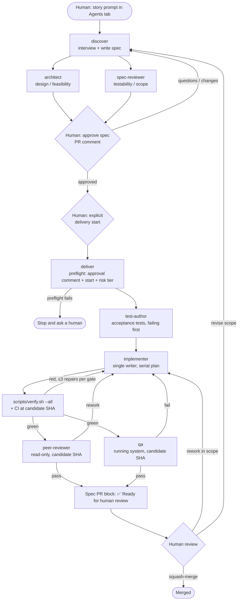

# How the agentic workflow works

> **Working document for PR #7.** It explains the process the agent
> definitions in `.github/agents/` describe, so the team can review the design
> before it goes live. Once the design settles, fold what's still true into the
> root `README.md` and delete this file (see [What happens to this file](#what-happens-to-this-file)).
> The step-by-step guide for people is [`human-playbook.md`](human-playbook.md).

## In one paragraph

A story goes from a rough idea to a merged PR in two halves, separated by
human decisions. **Discovery:** `discover` interviews the requester and writes
a spec; `architect` and `spec-reviewer` challenge it independently. **Human
approval:** a person with write access approves the spec's *Approved scope*
with a PR comment (`@copilot approved`), then separately starts delivery. **Delivery:**
`deliver` coordinates `test-author` (tests first), `implementer` (the only
writer), then `peer-reviewer` and `qa` against one candidate commit. A person
reviews the evidence and squash-merges. Agents never approve or merge.

## Lifecycle

Any change to code, tests, the base branch or the approved scope makes earlier
review and QA results stale. The next candidate SHA has to go through the gates
again.

## Who does what

| Role | Launched by | Reads | Writes | Must never |
|---|---|---|---|---|
| `discover` | Human (Agents tab) | story, `AGENTS.md`, `REVIEW.md`, code | the spec only | write code, record approval |
| `architect` | `discover` or human | spec, code, `REVIEW.md` | nothing (notes in its output) | edit the spec, approve |
| `spec-reviewer` | `discover` or human | spec, `REVIEW.md` | nothing (verdict in its output) | edit the spec, approve |
| `deliver` | Human, after approval | spec, approval record, PR state | spec bookkeeping (Progress, Review log, PR block) | approve, merge, widen scope |
| `test-author` | `deliver` or human | spec ACs, existing tests | test files only | touch production code, weaken tests |
| `implementer` | `deliver` or human | spec plan, code | code + tests | widen scope, weaken tests, rebase/force-push |
| `peer-reviewer` | `deliver` or human | diff at candidate SHA, spec, `REVIEW.md` | nothing (verdict) | check out or edit code |
| `qa` | `deliver` or human | spec, running app at candidate SHA | evidence artifacts | self-approve visual baselines |

"Launched by `discover`/`deliver` or human" means a human launches it whenever
an agent can't hand off to another agent. Nobody has shown that agent-to-agent
handoff works on this platform yet, so **for now, plan for humans launching
each role** (see the playbook).

## Where state lives

Everything durable is in **the spec file on the PR branch**. The PR
description is a copy of it.

| Spec section | Mutable? | Purpose | Authority |
|---|---|---|---|
| `Approved scope` | Only during discovery / approved revision | The contract: risk tier, problem, goals, non-goals, ACs, design, plan | **Authoritative** once approved |
| `Approval record` | Written once per approval | Link to the approval comment, who, when, plus the separate delivery start | **Authoritative** (backed by the linked PR comment) |
| `Progress` | Every step | Resume hint for a new session | **Not** authoritative |
| `Plan status` | Every task | Which plan tasks are done | Bookkeeping |
| `Review log` | Every gate | Gate, candidate SHA, findings, resolution | Evidence (must name the SHA) |
| `QA / UX matrix` | Per QA run | Cases, data, baseline, result, artifact link | Evidence |
| `PR description` block | Any time | Copied into the PR by `story-pr.yml` on push | Cosmetic |

The `Story PR` workflow (`.github/workflows/story-pr.yml`) is the only
automation. It opens or updates the draft PR from the spec, and it publishes
or re-drafts the PR depending on whether the block's first line is
`✅ Ready for human review`. It authorizes nothing.

## What is enforced versus convention

Be clear-eyed about this table before the pilot. Most controls are, for now,
**instructions an agent is asked to follow**.

| Control | How it's held today | Hard? |
|---|---|---|
| Humans merge | Repo permissions + branch protection (if configured) | Hard, **if configured** |
| Required CI green | Required status checks (if configured) | Hard, **if configured** |
| Spec approved before code | Agent instructions; agent must find the approval comment | Convention |
| Approval covers the current scope | Agent checks the Approved scope hasn't changed since the comment | Convention |
| Approver has write access | Team agreement on who approves; `@copilot` mentions are expected to work only for users with write access (verify) | Convention |
| Read-only reviewers | Agent instructions | Convention (no `tools:` restriction in the agent files) |
| Single writer | Agent instructions | Convention |
| ≤3 repairs per gate | Agent instructions | Soft by design |
| Different model for peer review | Agent instructions; usually unverifiable | Convention, often `unknown` |
| PR draft/ready mirrors spec | `story-pr.yml` | Automated, cosmetic |

## Known gaps to close before the first live story

These come from the PR #7 peer review. The playbook includes manual
workarounds for each one.

1. **Comment approval has no clear owner or version.** Sessions can probably
   read PR comments through the default read-only GitHub MCP server, but they
   can't tell who is an approver. And `discover`, which handles a session
   before delivery, may not record approval. Candidate fix: the comment names
   the head it approves (`@copilot approved <head-sha>`). Only the session that
   comment triggers counts as approval (Copilot only acts for users with write
   access). That session writes only the Approval record, and `deliver` checks
   that `## Approved scope` hasn't changed since `<head-sha>`. A second risk:
   a workflow edited on the branch could post the comment itself, so keep
   workflow-run approval on for Copilot pushes. See review round 2.
2. **Handoff is unproven,** so a story can take up to eight separately launched
   sessions. Candidate fix: let `deliver` run `test-author` and `implementer` in
   its own session by reading their definitions (as `ship` did with role
   checklists). Keep only `peer-reviewer` (and, if possible, `qa`) as separate
   sessions, where independence matters.
3. **Lifecycle commands are listed but not defined.** README lists `rework`,
   `revise`, `continue` and `stop`, but no agent definition says what to do on
   them. `sync` (bring `main` in after another merge), which `ship` had, is
   gone.
4. **Model independence is usually unknowable,** so every peer review will hit
   the "pause for a human exception" path. Decide up front whether a fresh
   session plus human review is an acceptable substitute.
5. **QA has no preview environment.** For the pilot, `qa` can realistically
   only drive Playwright against the local dev servers. Scope its matrix to
   that and mark the rest `unverified`.
6. **Legacy specs use the old template** (`docs/specs/3-shell-ui-and-api.md`
   still reads `Status: draft` with `Final review: SHIP`). Archive or annotate
   them so no session mistakes them for live stories.

## What happens to this file

This file is a review aid. The suggested end state of the repo once the design
settles:

- **Keep (canonical):** `.github/agents/*.agent.md`,
  `.github/copilot-instructions.md`, `AGENTS.md`, `REVIEW.md`,
  `docs/specs/_template.md`, `.github/workflows/*`, `scripts/verify.sh`.
- **Root `README.md`:** a short operator-facing overview plus the human
  runbook, linking to the agent files. Move the long rationale sections
  (costs, pilot metrics, model policy) into `docs/` or drop them.
- **`docs/`:** keep the playbook (or its condensed form) if the team wants a
  printable checklist. Delete this file once the gaps above are closed or
  tracked.
